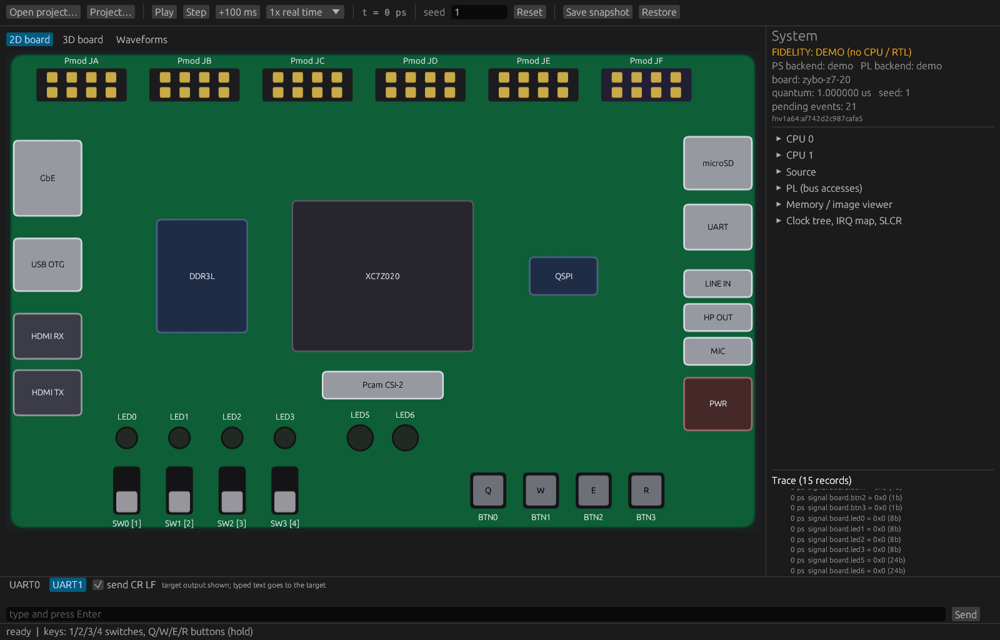
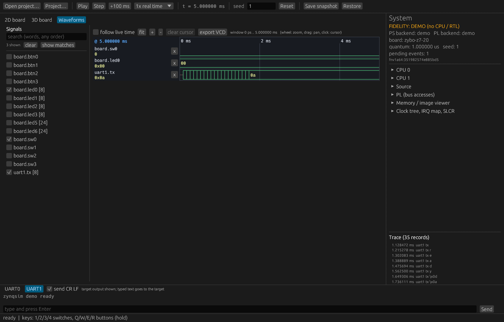
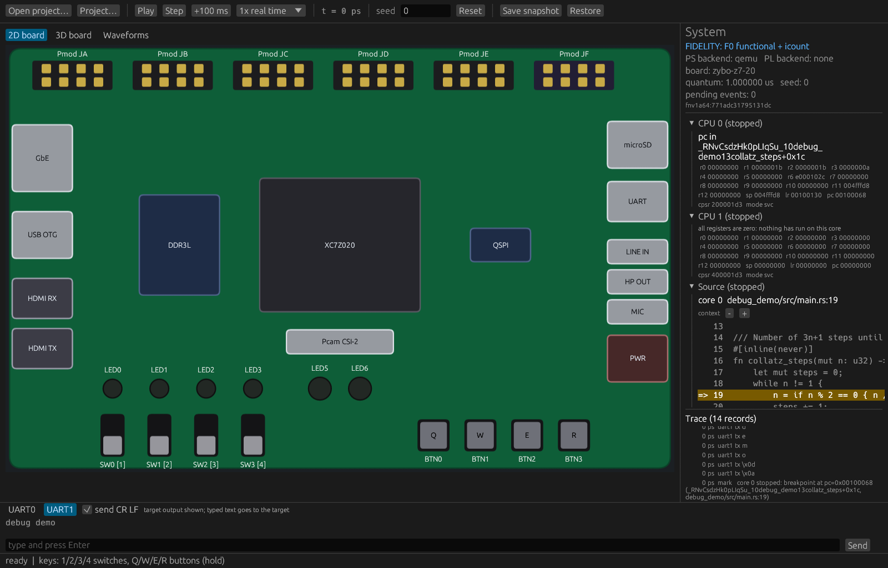
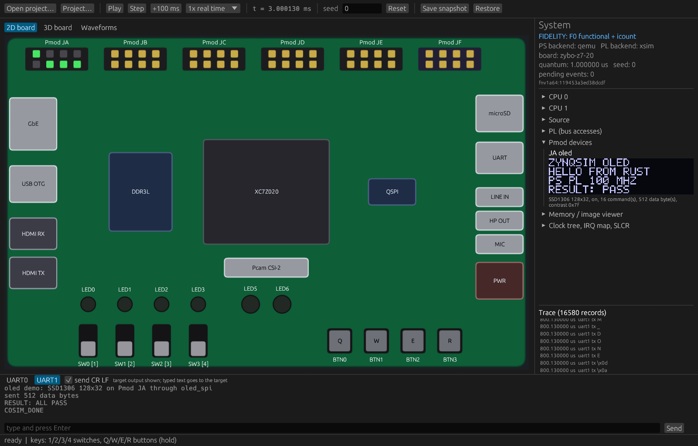
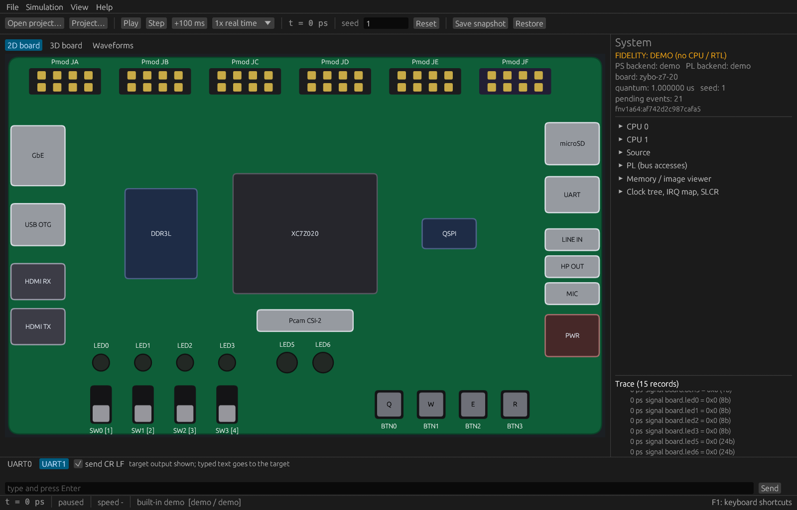
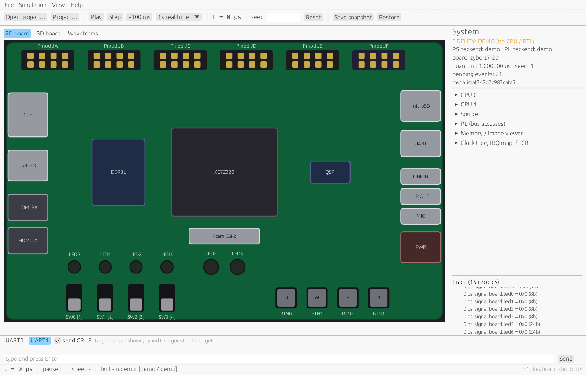
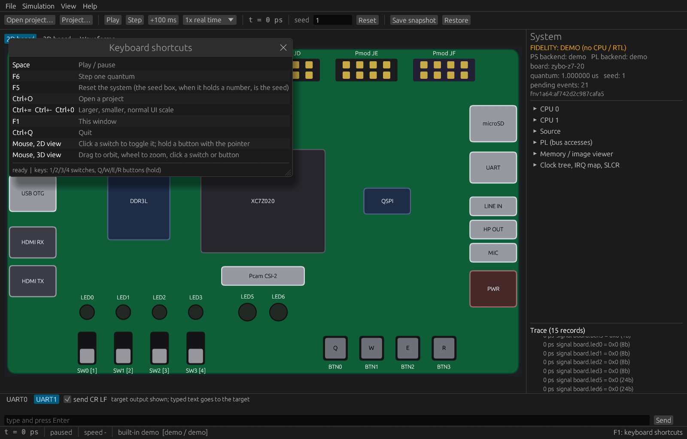

# ZynqSim

A deterministic simulator front end for **Zynq-7000 / Digilent Zybo Z7-20**: a virtual board
you can see, drive from a GUI, a CLI or an MCP server, and replay exactly.

> **Milestone P1 (locally verified).** Two kinds of engine sit behind the control plane:
> the built-in *demo* model (no CPU, no RTL, fidelity `demo`), and **Xilinx QEMU** (Cortex-A9,
> fidelity F0: functional with instruction-count timing) with a PL made of **native Rust models**
> or **RTL running in Vivado XSim**. The latter two need the Xilinx QEMU (Vitis) and, for RTL,
> Vivado, both located automatically. Read [docs/STATUS.md](docs/STATUS.md) before trusting any
> behaviour.

## Build and test

```
cargo build --release          # zynqsim, zynqsim-gui, zynqsim-mcp  (target/release)
cargo xtask ci                 # fmt --check, clippy -D warnings, tests, release build
```

Needs a Rust toolchain (stable). No external simulator is required to build or test. The GUI
links `cpal` (speaker; ALSA development files on Linux) and `rfd` (file dialogs); build with
`--no-default-features` to leave both out.

Installing from a release archive (no Rust needed), or building the archive yourself with
`cargo xtask dist`, and the Xilinx tools (optional): see [docs/INSTALL.md](docs/INSTALL.md).

## Use

```
zynqsim run --for 1s --at 10ms=sw0:on --at 20ms=btn1:tap --record session.json --vcd run.vcd
zynqsim test session.json                  # replay and check the trace digest (exit 1 on mismatch)
zynqsim inspect                            # board, backends, what is implemented
zynqsim bench --project examples/rust-hello/project.toml --for 100ms   # wall time, sim/wall ratio, PL cycles/s (docs/PERFORMANCE.md)
zynqsim-gui --project examples/demo/project.toml
```

Keys in the GUI: `1`-`4` toggle switches, `Q` `W` `E` `R` hold buttons. Shell keys: `Space` play or
pause, `F6` step, `F5` reset, `F1` the shortcuts window, `Ctrl+O` open a project, `Ctrl+=` / `Ctrl+-` /
`Ctrl+0` UI scale, `Ctrl+Q` quit.

### Waveforms

The **Waveforms** tab (next to 2D/3D board) shows the signals the trace recorded: board switches,
buttons and LEDs, UART bytes, Pmod pins, and `bus.<port>.addr/data/write` derived from every
PS/PL bus access. Tick signals in the list on the left (the search box takes words in any order),
then use the mouse wheel to zoom around the pointer, drag to pan and click to place a cursor; the
column left of the plot shows each value at the cursor (or under the pointer). **follow live
time** keeps the newest time at the right edge, **fit** shows the whole run and **export VCD**
writes the whole trace. 1-bit signals are drawn as steps, vectors as hex boxes, a signal with too
many changes for the window is marked "truncated: zoom in". Only signals recorded at the PL
boundary exist, not the design's internal nets (see `docs/adr/014-waveform-viewer.md`). The MCP
tool `waveform_get` returns the same windows as JSON, optionally drawn as SVG or PNG.

AXI protocol checkers run in every `init --ip` testbench by default and report VALID/READY,
reset, 4 KB, WLAST/RLAST and WRAP violations with their simulation time; `[rtl] protocol_checkers`
is `true` (warnings), `false` (off) or `"strict"` (errors fail the run). See
`docs/TEST_YOUR_DESIGN.md` section 4a and `docs/adr/025-protocol-checkers.md`.

### Run real firmware

```
cargo xtask dpi                                    # once: the XSim DPI library
zynqsim run --project examples/math-qemu/project.toml --for 20ms        # QEMU + native PL
zynqsim run --project examples/dma-regression/project.toml --for 3ms    # QEMU + RTL in XSim
```

`examples/dma-regression` is the prototype's two-core DMA regression; expect six `PASS` lines and
`RESULT: ALL PASS`. Add `--json` for the trace digest, which is identical from run to run.

### The virtual Zybo (interactive shell, LEDs, switches, buttons, image filter)

```
zynqsim-gui --project examples/board-demo/project.toml
```

Type `help` in the console. `led 5`, `img 1`, `bright 60`, `contrast 3`, `run 2 -100 1`, `status`,
`end`. Click the switches and buttons on the board (or press `1`-`4`, `Q` `W` `E` `R`); the LEDs
are driven by the RTL. Open **Memory / image viewer** and press *source image* / *result image* to
see the pixels the PL wrote. The same thing without a window:

```
zynqsim run --project examples/board-demo/project.toml --for 40ms \
    --at "3ms=uart1:img 1\r" --at "8ms=uart1:contrast 3\r" --at 20ms=sw1:on --at 25ms=btn2:down \
    --dump-image 0x01100000,64x64,result.png --dump-mem 0x01000000,16384,src.bin
```

Verified by tests (`cargo test`): the 4096-pixel results equal a Rust golden model, a button press
raises the GPIO interrupt and the firmware toggles the LED.

### Audio and HDMI

```
cargo xtask firmware                     # (optional; needs `rustup target add armv7a-none-eabi`) rebuild the Rust firmware ELFs in fixtures/elf
zynqsim run --project examples/audio-demo/project.toml --for 90ms \
    --audio-in tone:440:0.5 --audio-out out.wav     # codec output as a WAV, LINE IN = 440 Hz
zynqsim run --project examples/hdmi-demo/project.toml --for 40ms \
    --video-in photo.png --video-out tx.png         # HDMI TX picture as PNG, RX = your image
```

The firmware (`firmware/audio_demo`, `firmware/hdmi_demo`, Rust `no_std` for the Cortex-A9)
brings the SSM2603 up over I2C, plays a 1 kHz tone then loops LINE IN back, and draws a test card
in DDR that the PL scans out to HDMI while capturing the picture you supply. In the GUI open the
same projects: the **HDMI** and **Audio codec** panels show the picture and level, *listen on the
speakers* plays the codec output, and the source pickers change what the board receives.

### Ethernet (ping)

```
zynqsim run --project examples/net-demo/project.toml --for 10ms --pcap net.pcap
```

Rust firmware (`firmware/net_demo`: a Cadence GEM driver under smoltcp, the Rust counterpart of
lwIP) gets an address by DHCP and pings the simulated network's gateway four times; expect
`ping reply seq=0 bytes=32 ...` ... `RESULT: ALL PASS`, and a `net.pcap` (open it in Wireshark)
with the 14 frames and their virtual-time stamps. A project gets a NIC only with a `[network]`
section (`mac`, `subnet`, `gateway`, `restrict`); the network is QEMU's user-mode stack, so it
answers ARP, ping and DHCP itself and every run produces the same frames. In the GUI the
**Ethernet (GEM0)** panel shows the counters; in MCP `net_capture` returns the frames.
Design and limits: [docs/adr/011-ethernet.md](docs/adr/011-ethernet.md).
### SD card and QSPI flash

```
zynqsim sd-image --dir examples/sd-demo/sdcard --out sd.img      # FAT card from a folder
zynqsim qspi-image --file data.bin --offset 0x100000 --out flash.bin
zynqsim run --project examples/sd-demo/project.toml --for 2ms    # reads HELLO.TXT over SDHCI + FAT
zynqsim run --project examples/qspi-demo/project.toml --for 2ms  # JEDEC ID, FIFO and linear reads
```

`[storage]` in `project.toml` attaches the card (`sd_image` or `sd_dir`) and the flash
(`qspi_image` or `qspi_data`). Both are read-only unless `writable = true`, which writes guest
changes into the image file and refuses snapshot, reset and recording (ADR-012). The firmware
(`firmware/sd_demo`, `firmware/qspi_demo`) is verified against QEMU's models only.

### Load your own PS firmware and PL design

In the GUI use **Open project…**, or **Project…** to set the Cortex-A9 ELF and the RTL files
separately (*Load PS firmware…* keeps the PL, *Load PL design…* keeps the firmware; the compiled
RTL is cached so a firmware change does not recompile it). **Save project.toml…** writes the
result. The **3D board** tab shows the board in perspective: drag to rotate, wheel to zoom, click
the switches and buttons.

### Pmod OLED and RGB LEDs

```
zynqsim run --project examples/oled-demo/project.toml --for 4ms --device-out JA=oled.png
zynqsim run --project examples/rgb-demo/project.toml  --for 2ms --json     # "rgb": duty per LED channel
```

A Rust firmware drives an SPI master in the PL; the testbench reports the Pmod pins to the host,
where an SSD1306 model turns the traffic into the 128x32 picture. In the GUI the **Pmod devices**
panel shows it; MCP has `pmod_attach` and `pmod_frame`.

Device kinds for `[devices]`, `pmod_attach` and `--device-set`: `oled` (SSD1306 OLED), `tmp2`
(temperature), `als` (light), `acl` (acceleration), `pcam` (camera, on the CAM connector),
`8ld` (eight LEDs), `ssd` (two seven-segment digits), `btn` (four buttons and four switches, set
by the host) and `swt` (four switches, set by the host). The simple modules have a run example:

```
zynqsim run --project examples/pmod-simple-demo/project.toml --for 40ms --device-set 3ms@JB.btn0=1 --json
```

### Test your own firmware and IP

```
zynqsim init mytest --ip rtl/my_ip.v --elf fw/app.elf   # testbench + project.toml for an AXI4-Lite slave
zynqsim run --project mytest/project.toml --for 20ms --json
```

### From a Vivado hardware handoff

```
zynqsim init --xsa design.xsa --out mydesign --rtl rtl/my_ip.v --elf fw/app.elf
zynqsim run --project mydesign/project.toml --for 20ms
```

Reads the XSA (or a bare `.hwh`): PS7 clocks and ports, every PL IP with its VLNV, the address
map, interrupts and clocks. The user's AXI4-Lite RTL becomes `[rtl]` with a generated testbench;
`xsa-report.md` lists what was found, mapped and **not supported**. IP that has no model yet (AXI
GPIO, Timer, UART Lite, DMA, IIC, BRAM controller and interrupt controller run as `vendor-ip`
models, see below; any other Xilinx IP, VDMA for example) is recorded in `[xsa.unmodelled]` and makes `run` stop with a diagnostic naming it: the
project is generated, the design is not claimed to run. MCP: `project_create_from_xsa`. Details
and limits: [docs/adr/015-xsa-import.md](docs/adr/015-xsa-import.md).

### Xilinx IP without RTL

```
zynqsim run --project examples/gpio-timer-uart/project.toml --for 6ms
```

AXI GPIO, AXI Timer and AXI UART Lite are register-level models (`crates/vendor-ip`,
[ADR-016](docs/adr/016-vendor-ip.md)) that run on the native PL, or next to the user's RTL in
XSim. The example's firmware (`firmware/gpio_timer_uart`) walks the LEDs, takes timer
interrupts, writes a greeting through the UART Lite (`uart_read` port 2) and mirrors the switches
onto the LEDs; the design is the real Vivado XSA `fixtures/xsa/zs_vendor_ip.xsa`, which
`zynqsim init --xsa` turns into the same project. GPIO channels are bound to the board with
`[connect] "axi_gpio_0.GPIO" = "board.leds"` (`board.sw`, `board.btn`, `board.pmod_ja`..).
The register maps are written from the product guides from memory and are not verified against
hardware: see the `VERIFY:` items in [docs/STATUS.md](docs/STATUS.md).

The same models now also cover the AXI DMA (direct and scatter-gather mode, loopback on the
stream), the AXI IIC (master on a Pmod port, so the device models answer), the AXI BRAM
Controller and the AXI Interrupt Controller (ADR-021). Examples:

```
zynqsim run --project examples/dma-loopback/project.toml --for 4ms   # direct mode, Vivado XSA
zynqsim run --project examples/dma-sg/project.toml --for 3ms         # scatter-gather, hand-written
zynqsim run --project examples/iic-bram-demo/project.toml --for 8ms  # IIC reads a TMP2, BRAM
zynqsim run --project examples/intc-demo/project.toml --for 3ms      # INTC collects timer and GPIO
zynqsim run --project examples/timer-modes/project.toml --for 20ms \
  --at 3ms=btn0:down --at 4ms=btn0:up                                 # timer capture on a button, 64-bit cascade
```

The AXI Timer's capture and cascade modes (ADR-026) are bound like the GPIO channels: a
`CAPTURETRIG0` or `CAPTURETRIG1` input takes one switch or button (`[connect]
"axi_timer_0.CAPTURETRIG0" = "board.btn0"`).

The scatter-gather DMA has no Vivado handoff; its limits are in ADR-021 and STATUS.md.

### From a BOOT.BIN

```
zynqsim boot-info BOOT.BIN                      # partitions, register-init table, what is wrong
zynqsim init --boot BOOT.BIN --out myboot       # project with [boot] mode = "boot_bin"
zynqsim run --project myboot/project.toml --for 20ms
```

Reads the Zynq-7000 BootROM image `bootgen` writes (header and partition checksums, MD5
partitions) and starts the application partition(s) in the simulated PS: they are loaded at
their load addresses and core 0 starts at the execution address. The **FSBL is not executed**
and its register-init table (clocks, MIO, DDR) is listed, **not applied**; the PL bitstream
partition is recognised but cannot be simulated (the PL is the project's RTL); encrypted and
authenticated images are refused. MCP: `boot_inspect`. Details and limits:
[docs/adr/018-bootbin.md](docs/adr/018-bootbin.md).

### A Vivado design and its BOOT.BIN, end to end

```
zynqsim init --xsa fixtures/handoff/design.xsa --rtl fixtures/handoff/rtl/my_math_ip.v \
             --boot-bin fixtures/handoff/BOOT.BIN --out handoff
zynqsim run --project handoff/project.toml --for 8ms
```

`fixtures/handoff` is one Vivado 2022.1 block design (Zynq PS, the user RTL `my_math_ip`, AXI
GPIO, AXI Timer, AXI UART Lite) as an XSA and as an `export_simulation` folder, plus a `BOOT.BIN`
that `bootgen` packed around the Rust firmware `firmware/handoff_demo`. One `init` gives the
XSA-derived PL mapping and `[boot] mode = "boot_bin"` (`--boot-bin` is `--boot`, now also usable
next to `--xsa` or `--export-sim`); the firmware boots from the image, talks to the user RTL in
XSim and to the vendor-ip models, and prints `RESULT: ALL PASS`. With `--export-sim
fixtures/handoff/export/xsim` instead of `--rtl`, the RTL and its testbench come from the Vivado
export (the Xilinx IP still from the XSA) and the UART text and trace digest are the same. The
FSBL in the image is a **stub and is not executed**, the bitstream is a **placeholder and is not
simulated**, `ps7_init` is **not applied**: this is not Vivado's flow on a board. See
[examples/vivado-handoff](examples/vivado-handoff/README.md) and
[docs/adr/019-p3-exit.md](docs/adr/019-p3-exit.md).

### From a Vivado simulation export or a post-synthesis netlist

```
zynqsim init --export-sim export_sim/xsim --out mynetlist --elf fw/app.elf
zynqsim run --project mynetlist/project.toml --for 20ms
```

Takes an `export_simulation -simulator xsim` folder (or one `.prj`/`.f` list, or a single
`write_verilog -mode funcsim` netlist): the files are compiled in list order into their
libraries (Verilog, SystemVerilog and VHDL), with `-L unisims_ver` and `glbl`, include
directories and defines. A testbench is generated for the AXI4-Lite slave inside it unless the
export already brings one. `[rtl]` also takes `export_dir = "..."`, and `files` accepts globs
(`"rtl/**/*.v"`). Anything unsupported is printed with file, line and construct. The real Vivado
2022.1 exports in `fixtures/export` pass the same firmware with the same trace digest as the RTL.
MCP: `project_create_from_export`. Details: [docs/adr/017-export-simulation.md](docs/adr/017-export-simulation.md),
subset per backend: [docs/RTL_SUBSET.md](docs/RTL_SUBSET.md).

[docs/TEST_YOUR_DESIGN.md](docs/TEST_YOUR_DESIGN.md) covers the firmware side, what the generator
does and does not do, how to turn a run into a test, and how to debug a failure.

### Debugging the CPU

```
zynqsim-mcp            # then: project_open examples/math-debug, sim_run 1ms, cpu_regs
```

A project with `[debug] enabled = true` runs the Cortex-A9 under QEMU's gdb stub. `sim_run` stops
at a breakpoint (`[debug] breakpoints = ["main"]` or `breakpoint_set`), `cpu_regs` reads r0-r15
and the CPSR there, `symbol_lookup` maps addresses to ELF symbols, and the next `sim_run`
continues. Registers exist at stops, not at an arbitrary time, and timing under the debugger is not
reproducible (docs/adr/007-debugger-on-guest-stops.md).

#### Source lines

If the ELF has DWARF line info, stops are reported as `file:line` (docs/adr/013-dwarf-source.md):

```
zynqsim run --project examples/rust-debug/project.toml --for 1ms --break main.rs:38
zynqsim-mcp            # then: project_open examples/rust-debug, sim_run 1ms, cpu_regs, source_line
zynqsim-gui --project examples/rust-debug/project.toml --play   # at the stop: side panel "Source"
```

Breakpoints accept `main.rs:LINE` (a trailing part of the path is enough) in `[debug] breakpoints`,
`breakpoint_set location=` and `run --break`. `source_line` returns the file/line/function of an
address or symbol with the lines around it, `cpu_regs` has `pc_source` and `source_context`, and the
GUI's Source panel shows the file with the current line highlighted. Sources are found through the
compilation directory recorded in the ELF, the project directory and `[debug] source_dirs`.
`firmware/debug_demo` is built with `debug = 1` for this (`cargo xtask firmware`); the other
firmware ELFs carry no debug info. Only lines and function names are read: no variables, no stepping.

### Custom boards

Pick another board in `project.toml` (the demo engine, QEMU and XSim all follow it, and the
switch/button/LED counts reach the GUI, `zynqsim run --json` and the MCP tools):

```toml
[board]
name = "zedboard"            # built in: zybo-z7-20, zybo-z7-10, zedboard, pynq-z2
# or a board file of your own, relative to the project:
file = "my-board.toml"       # `name` is then optional (if given it must match the file's)
```

`zynqsim inspect --board zedboard|my-board.toml` summarises a board and checks a file;
`zynqsim run --board ...` runs the demo engine on one; the GUI's project window has a board picker.
`examples/custom-board` is a complete small board (TOML plus SVG artwork) with a project that runs
on the demo engine; `examples/zedboard-demo` drives the ZedBoard's 8 LEDs from Rust firmware
through an 8-bit RTL testbench (QEMU + XSim).

**The three built-in boards besides the Zybo Z7-20 were written from memory** of the vendors'
documents. Every pin, count, clock and peripheral in them is marked `VERIFY:` and **unchecked**
(`pin_status = "unverified"`); only how they load, draw and wire up is tested.

Board file format (TOML, `schema_version = 1`; coordinates are in a `layout` drawing space, origin
top-left, y down, every x/y is the **centre** of the item; ids are `[A-Za-z][A-Za-z0-9_]*`):

| Key | Meaning |
|---|---|
| `schema_version`, `name` (lower-case, digits, `-` `_`), `display_name`, `part`, `ddr_mb`, `pl_clock_hz`, `ps_clock_hz` | required |
| `pin_status` | `"unverified"` (default) or `"verified"` once checked against a schematic |
| `svg` | optional artwork path, relative to the board file (subset below) |
| `[layout]` `width`, `height` | drawing size; the picture is this size at scale 1 |
| `[resources]` | optional, informational: `luts`, `flip_flops`, `bram_36k`, `dsp_slices` |
| `[[switches]]`, `[[buttons]]` | `id`, `x`, `y`, optional `pin` (package pin) and `key` (one letter or digit: the GUI shortcut; switches toggle, buttons hold). At most **8** of each |
| `[[leds]]` | `id`, `x`, `y`, optional `pin`, `color` = `green` (default) `red` `yellow` `blue`. At most **8** |
| `[[rgb_leds]]` | `id`, `x`, `y`, optional `pin_r`, `pin_g`, `pin_b`; channels are named `<id>_r/g/b`. At most 2 |
| `[[pmods]]` | `id`, `x`, `y`, `domain` = `pl` or `ps`; pins are `<id>1..4` and `<id>7..10`. At most 6 |
| `[[connectors]]` | `id`, `kind`, `label`, `x`, `y`, `w`, `h`: drawn parts. Kinds: `soc ddr qspi ethernet usb_otg usb_host usb_uart hdmi_rx hdmi_tx vga microsd sd audio power pcam oled header fmc xadc jtag clock` |

Bit *n* of the testbench's `tel_ctrl` switches/buttons and of the `tel_event` LED mask is the
*n*-th `[[switches]]` / `[[buttons]]` / `[[leds]]` entry, which is why the limit is 8 (ADR-022).
Everything is validated when the board loads and **every** problem is listed: unknown tables,
fields, colours or connector kinds, items outside or overhanging the layout, duplicate ids, pins
or keys, names that collide with a Pmod or RGB pin name, too many components.

SVG artwork (optional): `rect circle ellipse line polyline polygon path` (commands `M L H V C Q Z`),
`g`, with `fill`, `stroke`, `stroke-width` and `opacity` (attributes or `style`); the view box is
stretched over the layout. Text, gradients, images and filters are skipped; transforms, `url()`
paints, percentage lengths and other path commands are rejected with a message. The 3D view
ignores the artwork. Details: `docs/adr/022-custom-boards.md`.

### MCP

```json
{ "mcpServers": { "zynqsim": {
    "command": "zynqsim-mcp",
    "args": ["--root", "C:/path/to/project"] } } }
```

Call `status_get` first and read `fidelity` and `capabilities`. Tools that need a CPU or RTL
backend are listed but return `unsupported` until those backends exist. `video_frame` and
`audio_capture` return the HDMI picture (PNG) and codec output (WAV); `media_source_set` chooses
what the board receives.

## GUI screenshots

Saved from real windows (`zynqsim-gui --screenshot FILE.png --exit-after-ms 60000`, Windows 11,
display scaling 125%); the images in `docs/screenshots/` are the ones this section links. Each was
looked at by hand; the layout defects found in that review, and what was changed, are in
`docs/STATUS.md` (*GUI panel appearance*).

| Default demo (2D board, System panel, trace) | Waveforms tab |
|---|---|
|  |  |
| **Source panel at a breakpoint** (`examples/rust-debug`) | **Pmod OLED** (`examples/oled-demo`) |
|  |  |

The window has a menu bar (File: open, recent projects, examples; Simulation; View: 2D, 3D,
Waveforms, side panel, console, UI scale, theme; Help) and a status line at the bottom (time, run
state, measured speed, project, backends, last error). Settings and recent projects are kept
between runs. The shell with the light theme, and its keyboard shortcuts window (F1):

| Default demo with the shell | Light theme |
|---|---|
|  |  |
| **Keyboard shortcuts (F1)** | |
|  | |

The side panel scrolls above a fixed trace strip; with the Source, HDMI or Audio panel open, the
sections below it are reached by scrolling it.

## Working on this repository with AI agents (token budget)

Development of this repository is done with Claude Code and sub-agents. Tokens are a budget, so:

* **Haiku for mechanical work**: formatting, `cargo clippy`, running and reading `cargo xtask ci`,
  committing finished worktrees, filling in docs rows from test names, re-running a flaky test
  alone. Give such an agent a short, numbered checklist and ask for a report under 150 words.
* **Sonnet for design and new features**: new device models, protocols, ingestion formats,
  anything where a wrong first decision costs a re-run. Resume a stopped agent with its id
  (`SendMessage`) instead of starting a new one, so its context is not re-derived.
* **One full gate per merge, not per branch**: `cargo xtask ci` takes 15+ minutes and is flaky
  when several gates, builds and XSim runs share the machine (see STATUS.md, "Known intermittent
  test failure"). Branch agents run targeted tests (`cargo test -p <crate> <name>`); the merged tree
  gets the one full run.
* **Agents in worktrees start from the repository's first commit**, not from your branch: begin
  with `git merge --ff-only <your-branch>`.
* Keep reports short and in files: long logs go to a file and only the failing lines are read.

## Universality corpus

Thirteen third-party permissively licensed RTL designs (CPUs, crypto cores, AXI-Stream and FIFO
blocks) run under Vivado XSim, plus negative cases for unsupported constructs. Table and
licences: [docs/CORPUS.md](docs/CORPUS.md); decision: [docs/adr/020-corpus.md](docs/adr/020-corpus.md).

## Layout

| Path | Contents |
|---|---|
| `crates/` | `sim-core`, `trace`, `board-zybo`, `devices`, `sim-api`, `mcp`, `cli`, `gui`, `xtask`, `interop`, `pl-api`, `pl-native`, `backend-qemu`, `backend-rtl-xsim`, `xsim-dpi` |
| `boards/` | board descriptions (TOML) |
| `docs/` | `DESIGN.md`, `STATUS.md`, `TESTPLAN.md`, `adr/` |
| `examples/` | `demo`, `custom-board`, `zedboard-demo`, `math-qemu`, `math-debug`, `dma-regression`, `board-demo`, `audio-demo`, `hdmi-demo`, `irq-demo`, `oled-demo`, `rgb-demo`, `rust-hello`, `rust-debug`, `net-demo`, `sd-demo`, `qspi-demo`, `bsp-hello`, `bsp-peripherals` (Xilinx's own BSP templates, unmodified), `gpio-timer-uart`, `timer-modes`, `dma-loopback`, `dma-sg`, `iic-bram-demo`, `intc-demo` projects |
| `firmware/` | Rust `no_std` Cortex-A9 firmware (`hello`, `audio_demo`, `hdmi_demo`, `irq_demo`, `oled_demo`, `rgb_demo`, `net_demo`, `sd_demo`, `qspi_demo`, `gpio_timer_uart`, `timer_modes`, `dma_loopback`, `dma_sg`, `iic_bram_demo`, `intc_demo`, `vendor_mix`); its own workspace, built by `cargo xtask firmware` |
| `fixtures/` | prototype firmware ELFs, the prebuilt Rust ELFs (`rust_*.elf`) and the RTL used by the examples and tests |

Requirements: [../docs/RUST_SOC_SIM_PROMPT.md](../docs/RUST_SOC_SIM_PROMPT.md).
Licence: Apache-2.0. Third-party crates: [THIRD_PARTY.md](THIRD_PARTY.md).
